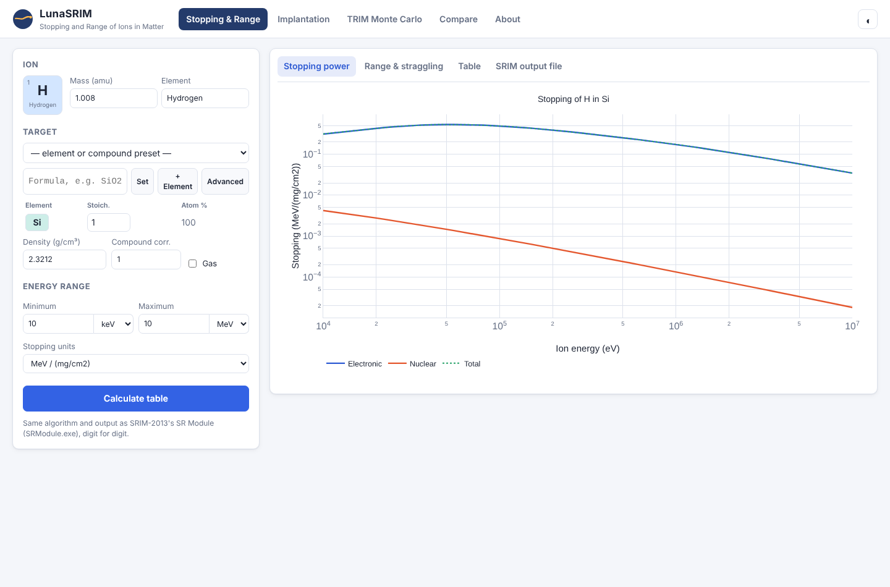
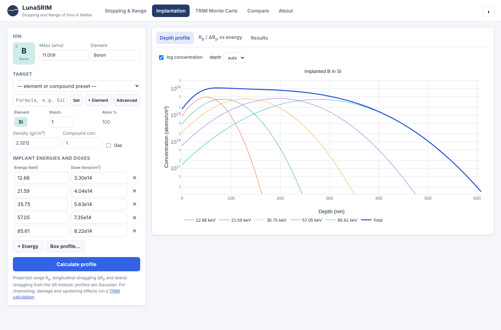
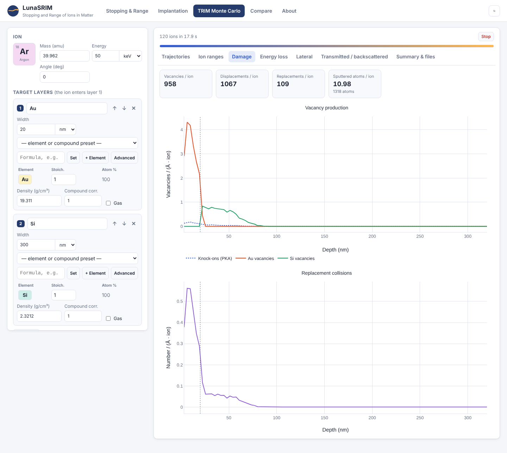
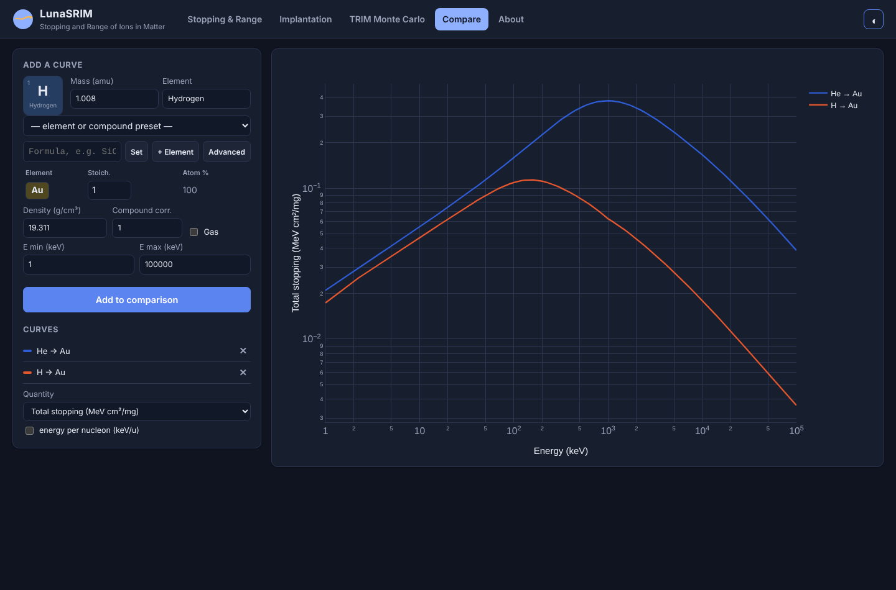

# LunaSRIM

A Python 3 re-implementation of **SRIM-2013**, obtained by reverse
engineering `TRIM.exe` and `SRModule.exe` from the
[costrouc/pysrim](https://github.com/costrouc/pysrim) docker image. It
covers TRIM (Monte Carlo transport of ions in matter) and the SR module
(tables of stopping powers, ranges and straggling).

TRIM is reproduced **ion by ion**: same random number sequence, same
physics, same Visual Basic arithmetic (including Single precision
variables, and the x87 math of the VB runtime) and the same output files.
For all 46 reference cases in `tests/reference`, the files written by
lunasrim are identical line by line to those of the original `TRIM.exe`,
including `COLLISON.txt` and `EXYZ.txt`;
see [Validation](#validation). The stopping and range tables are identical
to those of `SRModule.exe` (23 reference cases).

No Windows, wine or docker is needed to run calculations; the package is
pure Python (numpy is optional and only used by the result readers).

A **web application** runs on top of the package: stopping and range
tables, implantation profiles, TRIM Monte Carlo with trajectories and
damage plots, and comparisons of stopping curves. It is online at
**https://skowrons94.github.io/LunaSRIM/**, where the calculations run in
your browser (no server). See [Web application](#web-application).


## Installation

```sh
pip install .            # or just put the repository on PYTHONPATH
```

## Usage

### pysrim compatible API

```python
from lunasrim import Ion, Layer, Target, TRIM

ion = Ion('Ar', energy=50e3)                        # energy in eV
layer = Layer({'Si': {'stoich': 1, 'E_d': 15, 'lattice': 2, 'surface': 4.7}},
              density=2.321, width=2000)            # g/cm3, Angstrom
trim = TRIM(Target([layer]), ion, number_ions=1000, calculation=1,
            ranges=True, transmit=True, backscattered=True, sputtered=True)
results = trim.run('output/ArSi')    # TRIM.IN + 'SRIM Outputs/*.txt'

print(results.range.average_range, results.range.straggling)
print(results.vacancy.vacancies_per_ion)
depth, ioniz = results.ioniz.depth, results.ioniz.ions
```

The arguments follow pysrim's `srim.TRIM`. `calculation` is 1 (ion
distribution and quick Kinchin-Pease damage), 2 (full damage cascades) or
3 (monolayer collision steps / surface sputtering). Masses and surface
binding energies default to SRIM's values (most abundant isotope for the
ion, natural weight for target atoms). `TRIM.copy_output_files(src, dst)` is
available as in pysrim, so existing pysrim scripts only need
`from lunasrim import ...` and a directory for `run()`.

### Running a TRIM.IN file

```sh
python -m lunasrim TRIM.IN -o "SRIM Outputs"      # or: lunasrim TRIM.IN
python -m lunasrim TRIM.IN -n 100                  # override the number of ions
```

```python
from lunasrim import TrimInput, run_trim
engine = run_trim(TrimInput.read('TRIM.IN'), 'SRIM Outputs')
```

### Reading output files

`lunasrim.Results(directory)` reads RANGE, IONIZ, PHONON, E2RECOIL,
VACANCY, NOVAC, LATERAL, TRANSMIT, BACKSCAT, SPUTTER, RANGE_3D and TRIMOUT
files. It works the same for files written by the real SRIM.

### Stopping and range tables (SR module)

```sh
python -m lunasrim SR.IN            # writes the table file named in SR.IN
```

```python
from lunasrim import sr
sr.run('SR.IN')
rows = sr.stopping_table(1, 1.008, [(6, 1, 12.011)], density=2.253,
                         emin=10, emax=10000, units=7)
# rows: (E keV, S_elec, S_nuc, projected range A, long. straggling A, lat. straggling A)
```

The SR.IN format is the one of SRIM's "SR Module" and "Stopping and Range
Tables". With E-Min = E-Max = 0, a list of energies follows and only the
stopping powers are written. The range integration is the module's own
PRAL-type calculation. It runs on SRIM's energy grid with 50 sub-steps per
interval and accumulates the energy, which is why SRIM prints rows like
`999.999 eV`. For inputs where SRModule.exe stops with a run-time error (a
negative straggling variance), `sr.SrError` is raised.

The underlying stopping powers are also available directly:

```python
from lunasrim import stopping
stopping.electronic_stopping(1, 1.008, 6, 100.0)      # H in C at 100 keV, eV/(1E15 atoms/cm2)
stopping.nuclear_stopping(1, 1.008, 6, 12.011, 100.0)
stopping.compound_stopping(8, 15.999, [(1, 1.008, 2), (8, 15.999, 1)], 1000.0, phase=1)
```

### Energy loss and energy straggling

```python
from lunasrim.straggling import energy_loss
r = energy_loss(1, 1.008, 400, [(14, 1, 28.086)], density=2.3212, thickness=1, unit='um')
r['energy_out'], r['sigma'], r['fwhm']      # 330.46 keV, 4.48 keV, 10.56 keV
```

This gives the beam energy after a layer and its spread, without a Monte
Carlo. The thickness can be given in Å, nm, µm, mm, µg/cm², mg/cm²,
10¹⁵ atoms/cm² or atoms/cm².

- The **mean energy** is integrated with the SRIM stopping power
  (SRModule's S(E), electronic + nuclear, with the compound correction).
- The **variance** grows by the electronic straggling W(E). It is also
  stretched or narrowed by the slope of the stopping power:
  dΩ²/dx = W(E) − 2 (dS/dE) Ω².
- **W(E) is TRIM.exe's own model** (`trim.py`, electronic energy loss of
  each flight path). It is Bohr's straggling, 4πe⁴Z₁²Z₂N, with TRIM's
  relativistic factor and its integer mean Z₂. A low-energy reduction
  exists but only acts below a few hundred eV. Plain Bohr with the exact
  mean Z₂ is given too (`sigma_bohr`).
- **Nuclear collisions** enter the mean energy but not the spread. They
  give a low-energy tail, which a TRIM calculation shows (transmitted
  ions).

Against lunasrim's TRIM (4000 ions, the σ of the transmitted ions without
the nuclear tail, i.e. half the 16–84 % interval):

| ion, energy | layer | exit energy (analytic / TRIM median) | σ (analytic / TRIM) |
|---|---|---|---|
| H 400 keV  | Si 1 µm    | 330.5 / 331.6 keV | 4.48 / 4.55 keV |
| H 100 keV  | C 300 nm   | 50.1 / 50.1 keV   | 2.22 / 2.38 keV |
| He 2 MeV   | Au 300 nm  | 1799.8 / 1799.8 keV | 12.3 / 12.6 keV |
| He 300 keV | N₂ gas 200 µm | 258.5 / 258.3 keV | 2.72 / 2.89 keV |
| C 5 MeV    | Ni 500 nm  | 3485.2 / 3483.8 keV | 33.6 / 34.5 keV |

TRIM's σ is 2–7 % larger: its ions also differ in path length (angular
scattering) and in nuclear energy losses.

### Example scripts

`scripts/` has the original LunaSRIM calculations, now running on
lunasrim:

| script | calculation |
|--------|-------------|
| `F_in_Fe.py` | implantation of 40 keV F in Fe |
| `H_in_C.py`  | energy loss of 100 keV protons in 1000 A of carbon |
| `He_in_N.py` | angular straggling of 835.8 keV He in 22 cm of N2 gas |

```sh
./run.sh scripts/F_in_Fe.py        # results in output/F_in_Fe/
```

## Web application

```sh
pip install ".[web]"                 # fastapi + uvicorn
tools/fetch_web_vendor.sh            # optional: local copy of plotly.js for offline use
python -m lunasrim.web               # http://127.0.0.1:8000/
```

Or run it with Docker: `docker build -t lunasrim . && docker run -p 8000:8000 lunasrim`.

The web application has five tools.

**Stopping & Range.** This is the SRIM "Stopping and Range Tables":
- pick the ion from a periodic table, and an element, a chemical formula or
  one of SRIM's 356 compounds (with densities) as target;
- plot electronic and nuclear stopping, projected range and straggling in any
  of SRIM's 8 stopping units;
- view the table and download it as CSV or as the SRModule.exe output file.

**Implantation.** For one or more implant energies and doses it gives:
- the projected range, longitudinal and lateral straggling, and the Gaussian
  depth profiles with their sum;
- peak concentration and atomic fraction;
- R<sub>p</sub> ± ΔR<sub>p</sub> versus energy;
- a box-profile helper that chooses energies and doses for a flat
  concentration between two depths.

**Energy loss.** For an ion beam crossing one layer (element, compound or
gas; thickness as length, mass or areal density; tilted at an angle):
- the exit energy, the electronic and nuclear energy loss, and the mean
  energy in the layer;
- the energy straggling σ and FWHM (TRIM's model and Bohr's);
- the exit energy distribution, and the energy and straggling vs depth;
- a table and CSV of the depth profile.

**TRIM Monte Carlo.** You define multi-layer targets (elements or compounds,
gas or solid, with displacement, lattice and surface energies) and the
calculation type, then follow the run live. The results are:
- ion trajectories with recoil cascades, in three projections;
- the ion and recoil range distributions with a Gaussian fit;
- vacancies per element, replacement collisions, ionization, phonons and
  energy given to recoils;
- lateral spread and final ion positions;
- energy and angle spectra of transmitted, backscattered and sputtered atoms,
  with their mean energy, σ and FWHM;
- all of TRIM's output files, also as a zip.

A depth window (SRIM's plot window) sets the histogram resolution.

**Compare.** Overlay stopping, range or straggling curves of different
ion/target pairs, versus energy or energy per nucleon.

The server limits the number of ions per TRIM calculation
(`LUNASRIM_MAX_IONS`, default 100000) and the number of calculations that run
at once (`LUNASRIM_MAX_JOBS`, default 2).

### Online version (GitHub Pages)

The same application is published as a static site at
https://skowrons94.github.io/LunaSRIM/. The lunasrim package runs in the
browser with [Pyodide](https://pyodide.org) (Python compiled to
WebAssembly) inside a web worker, which answers the same `/api` requests as
the FastAPI server, so nothing is computed on a server. The engine loads
in a few seconds the first time; a TRIM calculation runs in slices so the
progress and the cancel button keep working. Without native x87 code the
math uses its pure-Python version; in the browser 45 of the 46 TRIM
reference cases are identical to TRIM.exe, and the other (HPbLong) differs
in one line of LATERAL.txt.

The site is built and deployed by `.github/workflows/pages.yml` on every
push to `main` (in the repository settings, Pages → Source must be
"GitHub Actions"). To build it locally:

```sh
python tools/build_static.py site      # downloads pyodide-core into site/pyodide
python -m http.server -d site          # http://127.0.0.1:8000/
```

| | |
|---|---|
|  |  |
|  |  |

## Validation

`tests/reference/` holds `TRIM.IN` files and the output files the original
`TRIM.exe` wrote for them. The cases cover:

- Kinchin-Pease and full cascades, and sputtering mode;
- gas and compound layers;
- compounds from the dictionary (Kapton, Mylar, PMMA, bone, quartz, air,
  GaN, GaAs), up to 7 elements, with fractional stoichiometries and missing
  binding energies;
- mixed targets such as Mylar / air (gas) / Si;
- several layers, including non-integer widths;
- oblique incidence and a plot window.

More edge cases cover:

- heavy ions in light targets (2 MeV Au in C) and light ions in heavy ones
  (10 MeV H through 0.4 mm of Pb);
- very low (100 eV Ar on W) and very high (200 MeV Xe in Si) energies;
- glancing incidence (1 keV Ne on Si at 85 degrees);
- Bragg corrections different from 1, the same element in several layers
  (Si / SiO2 / Si), an 8-element steel, a plot window that does not start at
  the surface, and a 1 mm argon gas layer in front of tungsten.

- the collision files: `COLLISON.txt` for Kinchin-Pease, for full cascades
  with damage counts, and with the listing of every recoil cascade, and
  `EXYZ.txt` with stopped, transmitted and backscattered ions.

All 46 cases match line by line, without exceptions, and lunasrim writes
the same set of files as TRIM.

A further campaign of 57 TRIM inputs and 24 SR inputs was run once against
the binaries (not kept in the repository). It covered:

- ion and energy extremes: 10 eV H, 1 GeV U, 89 deg incidence;
- targets: 8 layers, 1 A layers, gas/solid/gas stacks, 10-element compounds;
- every calculation mode and output-file switch;
- spellings of TRIM.IN numbers (`2000`, `2000.0`, `2E3`, widths above
  32767);
- SR units, energy limits, compound corrections and list modes.

It found two output bugs, which are fixed. The first was the TRIMOUT.txt
content when only some files are switched on. The second was the header
when the compound correction is 0. After the fixes all cases are identical.
Above 5.92 GeV/u SRIM's stopping routine overflows in `Exp`, and
SRModule.exe stops with a run-time error. lunasrim raises `SrError` there,
and in the web app's tables it stops at that energy.

`tests/reference_sr/` does the same for `SRModule.exe` and 24 `SR.IN`
files: H to U ions, solids, gases and compounds (bone, Kapton, PMMA, steel,
air, CO2, water), all 8 stopping units, eV to GeV energies, and Bragg
corrections, in both table and list modes. All of them are identical to the
original output. Three more inputs make `SRModule.exe` stop with a run-time
error; lunasrim raises `SrError` for them.

```sh
python -m unittest discover tests        # or: pytest
```

The tools to produce such references are:

```sh
tools/extract_srim.sh srim               # copy SRIM-2013 out of the docker image
tools/run_real_trim.sh some/dir          # run TRIM.exe (wine, docker) on some/dir/TRIM.IN
tools/validate.py some/dir               # run lunasrim on it and diff every output file
tools/run_real_sr.sh some/dir            # run SRModule.exe on some/dir/SR.IN
tools/validate_sr.py some/dir            # compare lunasrim's table with it
```

Exact agreement needs the arithmetic of the VB runtime, not just the same
formulas (see [How it was done](#how-it-was-done)). lunasrim runs the
runtime's x87 instruction sequences natively on x86-64 (`lunasrim/vbmath.py`,
source in `tools/vbmath.S`). The x87 transcendental instructions differ in
the last bit between CPU vendors, and the references were made on an Intel
CPU, so the native `Exp`, `Log`, `^`, `Atn`, `Sin` and `Cos` are used only
when they reproduce the Intel values (checked at import). On other
processors (e.g. AMD), or if executable memory
is not available (`LUNASRIM_NO_NATIVE_MATH=1` forces this), it uses
Python's `math` module and an exact model of the 64-bit square root
instead. Then all reference cases but one are still identical: one
LATERAL.txt value of `HPbLong` differs in its last digits.

## What is implemented

- Target setup: layers, compounds, gas and solid phases, Bragg corrections,
  and SRIM's per-element electronic stopping tables.
- Ion transport: free flight path, the MAGIC scattering integral, and
  electronic energy loss with straggling.
- Recoils: Kinchin-Pease damage, full cascades, and monolayer steps with
  sputtering.
- Output files: `TDATA`, `RANGE`, `LATERAL`, `IONIZ`, `PHONON`, `E2RECOIL`,
  `VACANCY` and `NOVAC`.
- Per-ion files: `TRIMOUT`, `TRANSMIT`, `BACKSCAT`, `SPUTTER` and `RANGE_3D`.
- Collision files: `COLLISON.txt` (both detail levels) and `EXYZ.txt` (also in
  the web app, with an ion energy vs depth plot), with
  readers (`Results(...).collisions`, `Results(...).exyz`).
- SR module: stopping and range tables, and stopping for energy lists.

Not implemented:

- TRIM's special modes 4-8 (neutron and ion-only calculations; partly
  present but untested);
- auto-save and restore of a calculation.

## How it was done

The binaries are Visual Basic 5 native code. They were decompiled with
Ghidra and run in a small Unicorn-based x86 emulator of the VB runtime. The
emulator traced the program's variables and random numbers, and each
Python routine was compared against it value by value. Findings that matter
for exact agreement:

- **Random numbers.** The RNG is L'Ecuyer's combined generator without
  shuffling, using VB's `CLng` (round half to even). The "Reminders" field
  of TRIM.IN is the second seed. The RNG state is restored after a recoil
  cascade (calculations 1-3), so ion trajectories do not depend on recoils.
- **Variant typing.** TRIM's variables are VB Variants, so arithmetic follows
  the OLE type rules: Integer / Integer gives a Single, Single × Integer
  gives a Single, and so on.
  - The depth bin width is therefore a Single for integer layer widths, and
    the tallies accumulate in single precision.
  - The ion mass and the recoil arrays are Singles, and the stoichiometry
    sums are done in single precision.
- **Number formatting.** VB's `Str$`/`CStr` use 15 significant digits (7 for
  Singles). `Format$` rounds a 17-digit conversion for scientific formats
  (`0000.E+00`) and a 15-digit one for fixed-point formats (`0000.0`), so
  61/20 prints as 3.1 but 5625.035 as `562503.E-02`. Some output
  columns keep a format string or a fixed-length string field from the file
  written before them.
- **x87 precision and the VB runtime math.** SRIM's VB runtime puts the x87
  FPU in 64-bit precision (control word 0x137F, read with winedbg inside
  TRIM's collision loop and in SRModule.exe). `Sqr` is therefore rounded to
  64 bits and then to a Double, which often differs from a correctly
  rounded square root for arguments just below 1 (the normalisation of the
  direction cosines). `Exp` and `^` are Microsoft C runtime x87 sequences
  (`fyl2x`, `f2xm1`, `fscale` at 64-bit precision); `Log`, `Atn`, `Sin` and
  `Cos` return the 80-bit result of one x87 instruction. They differ from
  the C library in the last bit for about 0.1 % of the arguments. In a gas
  layer the deflections are tiny, so `sqrt(1 - cx^2)` cancels and amplifies
  such a bit until a trajectory changes. These routines were checked
  against msvbvm50.dll itself: a small Windows program calls its exports
  under wine on 600,000 random arguments, and lunasrim's routines agree on
  all of them.

## Repository structure

- `lunasrim/`: the package.
  - `trim.py`: the Monte Carlo engine.
  - `trim_setup.py`: target constants.
  - `stopping.py`: stopping powers.
  - `sr.py`: SR module (stopping and range tables).
  - `output.py`: output files.
  - `srim.py`: API.
  - `results.py`: readers.
  - `trimin.py`: TRIM.IN.
  - `rng.py`: random numbers.
  - `vbfmt.py`: VB number formatting.
  - `vbmath.py`: VB runtime math (x87 routines of msvbvm50.dll).
  - `straggling.py`: energy loss and energy straggling through a layer.
  - `tally.py`: distributions.
  - `compounds.py`: SRIM's compound dictionary.
  - `web/`: the web application (`core.py` logic, FastAPI server, Pyodide
    entry point `pyodide_api.py`, and the browser front end).
  - `data/`: SRIM-2013 data files (`SCOEF03.DAT`, `SNUC03.dat`, `ATOMDATA`, `Compound.dat`; (c) J. F. Ziegler).
- `scripts/`: example calculations.
- `tests/`: regression tests against TRIM.exe and SRModule.exe.
- `tools/`: helpers to extract and run the original SRIM through docker and to validate lunasrim against it.

SRIM is written by J. F. Ziegler, J. P. Biersack and M. D. Ziegler
(www.srim.org). When publishing results, cite SRIM.
