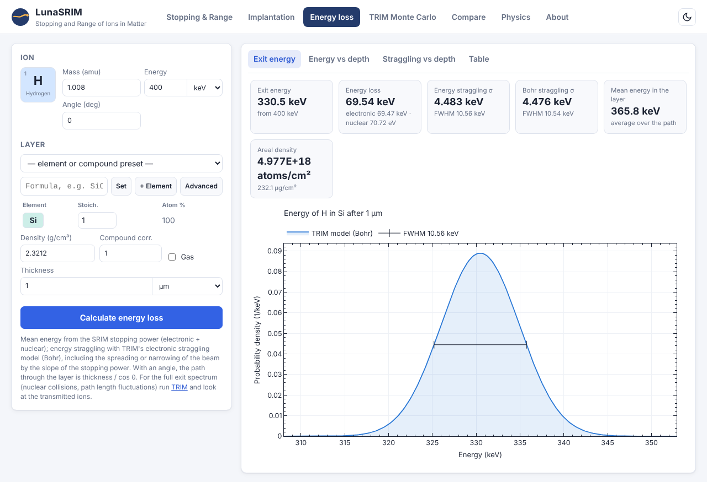

# Web application

The web application is a graphical interface to lunasrim in the style of SRIM's programs. It runs in two forms with the same interface and the same results: a static website on GitHub Pages, where the Python package runs in the browser, and a local server based on FastAPI.

## Tools

The application has seven tabs.

Stopping & Range. The SR module of SRIM. The ion is chosen from a periodic table and the target is an element, a chemical formula or one of the compounds of SRIM's dictionary, with its density. The tool plots the electronic and nuclear stopping, the projected range and the straggling in any of SRIM's eight stopping units, shows the table, and offers it as CSV and as the output file of `SRModule.exe`.

Implantation. For one or more implantation energies and doses the tool gives the projected range $R_p$, the longitudinal straggling $\Delta R_p$ and the lateral straggling from the SR module, the Gaussian depth profiles and their sum (physics.md, Section 7), the peak concentration and atomic fraction, and $R_p \pm \Delta R_p$ versus energy. A box-profile helper chooses energies and doses for a flat concentration between two depths. The profiles are Gaussian; for the exact shape, damage or several layers, a TRIM calculation is needed.

Energy loss. For a beam crossing one layer (element, compound or gas, with the thickness as a length, a mass thickness or an areal density, and the layer tilted by an angle), the tool gives the exit energy, the electronic and nuclear energy loss, the mean energy in the layer, the energy straggling $\sigma$ and FWHM with TRIM's model and with Bohr's formula, the exit energy distribution, the energy and the straggling versus depth, and the depth profile as a table and CSV (physics.md, Section 6).

TRIM Monte Carlo. The target has one or more layers of elements or compounds, solid or gas, with displacement, lattice and surface binding energies. The calculation type (Kinchin-Pease, full cascades or monolayer sputtering), the number of ions, the random seed, the number of trajectories drawn, the depth window of the histograms (SRIM's plot window), the energy interval of `EXYZ.txt` and the detail of `COLLISON.txt` are set before the run. The run can be followed and stopped. The results are:

- ion trajectories with recoil cascades, in three projections;
- the ion and recoil range distributions with a Gaussian fit;
- vacancies per element, replacement collisions, ionisation, phonons and energy given to recoils;
- the lateral spread and the final ion positions;
- the energy and angle spectra of transmitted, backscattered and sputtered atoms with their mean energy, $\sigma$ and FWHM;
- all output files of TRIM, one by one or as a zip file.

Compare. Stopping, range or straggling curves of several ion-target pairs, versus energy or energy per nucleon.

Physics. The document [physics.md](physics.md), with its formulas.

About. A summary of the package and how to cite SRIM.



## Online version

The static site at https://skowrons94.github.io/LunaSRIM/ needs no server. The lunasrim package runs in the browser with [Pyodide](https://pyodide.org), Python compiled to WebAssembly, inside a web worker. The worker answers the same `/api` requests as the FastAPI server, so the front end is the same. The first visit downloads the Pyodide runtime and the package, about 14 MB before compression (10.1 MB of which is the WebAssembly file of Pyodide), and the browser caches them. A TRIM calculation runs in slices, so that the progress display and the stop button keep working.

In the browser there is no native x87 code, so lunasrim uses its pure Python math (validation.md). 45 of the 46 TRIM reference cases are then identical to `TRIM.exe`, and in the other one (`HPbLong`) one line of `LATERAL.txt` differs in its last digits. The static site accepts at most 100000 ions per TRIM calculation. The calculation runs on the visitor's computer and is slower than with a local Python installation.

## Running it locally

```sh
pip install "lunasrim[web]"           # FastAPI and uvicorn
lunasrim web                          # http://127.0.0.1:8000/
lunasrim web --host 0.0.0.0 --port 8080    # reachable from other computers
```

`python -m lunasrim.web` does the same. The page loads plotly.js (plots), marked and KaTeX (Physics tab) from local copies in `lunasrim/web/static/vendor/` if they exist, and from a CDN otherwise. In a checkout, `tools/fetch_web_vendor.sh` downloads the local copies, so that the application works without internet access.

### Server settings

Two environment variables limit the load on the server:

| variable | default | meaning |
|---|---|---|
| `LUNASRIM_MAX_IONS` | 100000 | maximum number of ions of one TRIM calculation |
| `LUNASRIM_MAX_JOBS` | 2 | number of TRIM calculations that run at the same time |

Further calculations wait until a slot is free. The server keeps the output files of each calculation until it is removed; `GET /api/trim/{id}/files.zip` returns them.

## Docker

The repository contains a `Dockerfile` for the server:

```sh
docker build -t lunasrim .
docker run -p 8000:8000 lunasrim                                  # http://localhost:8000/
docker run -p 8000:8000 -e LUNASRIM_MAX_IONS=20000 lunasrim       # with another limit
```

The image installs the package with `pip install ".[web]"`, fetches the JavaScript libraries, and runs `lunasrim web --host 0.0.0.0 --port 8000` as an unprivileged user.

## Building the static site

```sh
python tools/build_static.py site      # downloads pyodide-core into site/pyodide
python -m http.server -d site          # http://127.0.0.1:8000/
```

`tools/build_static.py OUT_DIR` copies the front end into `OUT_DIR`, marks it as static, packs the Python sources and data of lunasrim into `lunasrim.zip`, and installs the Pyodide runtime (pyodide-core 0.26.4) into `OUT_DIR/pyodide`. It downloads Pyodide from its GitHub release unless `--pyodide DIR_OR_TARBALL` gives a local copy. Any static web server can serve the result.

## Deployment

The workflow `.github/workflows/pages.yml` builds and deploys the site on every push to `main` and on manual dispatch. It runs the tests of the SR module, the web API, the x87 math, the static API and the energy straggling, fetches the JavaScript libraries, builds the site with `tools/build_static.py site` and publishes it with GitHub Pages. In the repository settings, Pages, the source must be "GitHub Actions" (a one-time setting).

The Physics tab shows `lunasrim/web/static/physics.md`, a copy of `docs/physics.md` that is part of the package. After editing `docs/physics.md`, run `python tools/sync_docs.py`; `tests/test_docs_page.py` fails while the two files differ.
